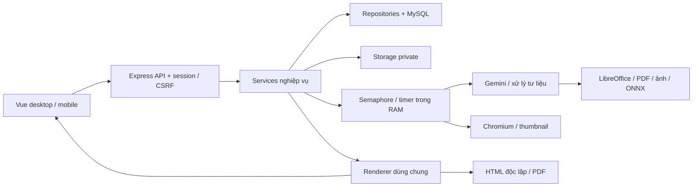

# Audit MISA HTML Presentation

Ngày: 11/10/2026 · Bản để duyệt kế hoạch, chưa sửa ứng dụng.

Repository: `/Users/tuanbui/MISA-HTML-presentation` · baseline commit `ec7bdf78d1928c7c66477109761fcc57451873c7`, snapshot 10:24:43 ngày 11/10/2026.

**Lưu ý về phiên bản:** working tree có thay đổi song song sau snapshot, gồm layout org/redraw. Đã đọc bổ sung diff và thêm 8 case DELTA; kết quả 134 unit/build dưới đây chỉ thuộc baseline. Xem [phụ lục thay đổi đồng thời](07-thay-doi-dong-thoi.md).

**Kết luận:** ứng dụng có nền tảng tốt, nhưng chưa đủ bằng chứng để bàn giao production với mục tiêu 500 người dùng đồng thời. Có lỗi nghiệp vụ tái hiện được, khoảng trống kiểm thử ở các ranh giới quan trọng, và giới hạn vận hành một tiến trình. Nên nâng cấp theo từng lớp, giữ kiến trúc hiện có, dựng lưới kiểm thử trước rồi mới sửa hành vi.

## 1. Phạm vi và độ tin cậy

Áp dụng [misa-backend-standards](/Users/tuanbui/.codex/skills/misa-backend-standards/SKILL.md), nguồn chuẩn `/Users/tuanbui/BackEnd.SKILL`: 00, 01–09, 11, 13, 20. Tên người dùng gọi là “misa-backend-skill”; bản tương ứng tìm được trong Codex có tên trên, phía Claude có `misa-backend-standard`. Đây là audit/refactor dự án cũ.

Đã khảo sát cấu trúc toàn repository, tài liệu memory-bank, routes/middleware, services/repositories, schema/changelog, cấu hình Docker/Nginx, công cụ build, bộ test, các luồng giao diện desktop/mobile và renderer dùng chung. Phân tích sâu tập trung vào ranh giới quyền, dữ liệu, tác vụ nền, xuất bản và cập nhật đồng thời. Không có nghĩa mọi dòng CSS, font, binary ONNX hoặc thư viện ngoài đều được review thủ công. Kiểm kê 306 tệp tracked; manifest 305 tệp loại `.env.example`. Không đọc `.env` hay bí mật vận hành.

Đây là kiểm chứng mã nguồn và chạy kiểm thử cô lập, **không phải chứng nhận production, pentest hoàn chỉnh, đo tải 500 người thật hay audit hình thức MDS 2.0**. Lịch sử memory-bank có ghi nhiều lần kiểm thử thủ công trước đây; coi đó là thông tin lịch sử, không thay thế kết quả thực thi của lần audit này.

| Kiểm chứng | Kết quả | Giới hạn |
|---|---|---|
| Unit hiện có | 15 tệp, 134/134 pass; 0 fail/skip | Hai lỗi socket ở lần đầu do sandbox; chạy lại môi trường được phép mở socket đạt toàn bộ |
| Build | Vite và bundle runtime 3D thành công | Build trên snapshot cô lập, dùng dependency đã có; chưa phải clean `npm ci` hay Docker image build |
| Probe lỗi | 7 tình huống bất thường được tái hiện bằng mã thật và phụ thuộc giả lập | Không thay thế giao dịch MySQL thật hoặc E2E trình duyệt |
| Probe phủ định | Chặn được 3 địa chỉ IPv4-mapped IPv6 private | Đã loại bỏ giả thuyết bypass SSRF này khỏi finding |
| Integration/E2E/load | Không tìm thấy suite tracked tương ứng; script integration trỏ thư mục chưa tồn tại | Có thể có CI bên ngoài repository; chưa được cung cấp bằng chứng |
| Gemini/Pixabay/YouTube thật | Chưa chạy | Không dùng credential thật hay phát sinh chi phí trong audit |
| Claude phản biện trực tiếp | Sau khi được phép gọi ngoài sandbox, CLI báo OAuth hết hạn, không refresh được | Chưa có kết luận độc lập từ Claude; không phủ nhận phiên Claude khác đang hoạt động; có hồ sơ gửi kèm |

Coverage native trên **các tệp được import trong lần chạy**, không phải toàn bộ repo: line 71,97%, branch 84,81%, function 85,31%. `presentationService` chỉ 9,73% line; repository presentation 6,46%; media 24,20%; storage 13,51%. Auth/routes và nhiều thành phần giao diện không xuất hiện trong báo cáo. Vì vậy không dùng số 71,97% để nói rằng toàn bộ sản phẩm đã được bảo vệ.

## 2. Bản đồ ứng dụng và các chủ đích cần giữ

- Node/Express/MySQL, Vue/Vite; dependency injection qua container; phân tầng routes → services → repositories tương đối rõ. Không có lý do đổi framework hay chuyển TypeScript toàn dự án chỉ để “đúng chuẩn”.
- Người dùng là tenant. Admin quản trị tài khoản **không được đọc bài private của người khác**. Owner/editor/viewer là quyền trên bài; public có nghĩa công khai cho người đã đăng nhập. Viewer được xuất/nhân bản là chủ đích ghi trong lịch sử, không tự coi là lỗ hổng.
- Tạo bài qua `outlining → outline → generating → ready`; lỗi bước dựng quay lại dàn ý để sửa/thử lại. Phân biệt chuẩn hoá lenient đầu ra AI với strict khi người dùng lưu.
- Dàn ý duyệt trước; nhiều nguồn tài liệu, URL, văn bản, ảnh/video gửi kèm, âm thanh/OCR, nhận diện sơ đồ/ảnh giao diện; AI minh hoạ tuỳ chọn.
- 13 bố cục dựng bài cùng trang free; sửa chữ trực tiếp, rich text, ảnh, logo, brand, nền/phông/màu, lớp trang trí, di chuyển/kích thước chữ, trình chiếu từng ý, 3D. Desktop/mobile chia sẻ composable.
- MySQL chứa users, presentations, assets, templates/assets của template, shares, versions, sessions, audit và schema markers. Storage nằm ngoài static public, có tenant path, chữ ký URL cho sandbox.
- `specVersion`, `outlineVersion`, baseline lần đầu chia sẻ, tối đa 5 handoff. **Handoff đã dùng transaction và khoá dòng**; phải giữ và kiểm thử MySQL thật, không đánh giá sai rằng tất cả versioning đều thiếu khoá.
- Có parameterized SQL, allowlist trường request, CSRF, regenerate session, session-version revocation, CSP/escape, SSRF DNS/redirect checks, non-root Docker, timeout một số dịch vụ, tách AI cutout sang worker thread. Đây là tài sản cần bảo toàn.

## 3. Findings có ưu tiên

P1: cần giải quyết trước bàn giao production. P2: phải hoàn tất hoặc có bằng chứng không áp dụng trước tuyên bố tuân thủ đầy đủ. Không gắn P0 khi chưa chứng minh sự cố nghiêm trọng đang xảy ra. “Tái hiện” dưới đây ghi rõ tầng; không suy rộng mock thành kết quả tải thật.

| ID | Mức | Phát hiện và bằng chứng | Hướng xử lý / work item |
|---|---|---|---|
| F01 | P1 | `presentationService.js:176,184,426` gọi `storeImage(owner,id,kind,img,name)` trong khi hàm tại 619 nhận `(deck,kind,img,name)`. Probe tạo text+PNG nhận `outlining` rồi `failed`; storage key có tenant `undefined`, buffer thiếu. Nhánh minh hoạ AI dùng cùng chữ ký sai nhưng bắt lỗi nên có thể âm thầm thiếu ảnh. | Test red cả ảnh gửi kèm, poster, minh hoạ; chuẩn hoá hợp đồng đối tượng deck + options, kiểm chứng tenant/kind/buffer. W03 |
| F02 | P1 | `useEditor.js:118–121`: draft A từ v1 được giữ, nhưng metadata response cập nhật deck lên v2 của B; lần lưu A gửi v2 và ghi đè B. `save():95` adopt response cũng xoá phần gõ thêm trong lúc chờ. Đã tái hiện cả hai với composable thật, API/ref giả lập. `useOutline.save` có pattern tương tự cần E2E. | Tách server snapshot, draft baseVersion và local revision. Meta không rebase nội dung âm thầm; response chỉ đánh dấu snapshot đã gửi, giữ phần sửa mới. W04 |
| F03 | P1 | `server.js:18–20`, `presentationRepository.js:252–260`: startup phục hồi toàn bộ trạng thái đang xử lý, không có owner/lease; `cleanupUploads(0)` dọn upload chung. Queue/timer trong RAM. Restart mất job; thêm replica có thể can thiệp job/upload của tiến trình khác. Tài liệu đã thừa nhận chỉ hỗ trợ một instance. | Job bền vững, lease/heartbeat/fencing, checkpoint, idempotency, upload staging do job sở hữu. Đây là nâng cấp cho mục tiêu mới, không phủ nhận lựa chọn MVP. W09–W11 |
| F04 | P1 | `security.js:109` limit chung 600 request/phút/IP và memory store; API asset cũng nằm sau limiter. 500 người cùng NAT, chỉ 1 request/5 giây đã là 6.000/phút. Đây là tính toán cấu hình, chưa là benchmark. | Pre-auth IP chống abuse; authenticated user bucket; hạn mức riêng chi phí lớn, store chia sẻ, Retry-After. Kiểm thử NAT thật. W07 |
| F05 | P1 | `semaphore.js` chỉ chặn số active, queue không có cap/deadline/cancel. `presentationService.js:766–790,825,846` nạp toàn bộ media trước browser admission; thumbnail một trang cũng đọc tất cả ảnh. HTML nhúng video tới 200 MB gồm cả asset chưa dùng; base64 tăng ~1/3 chưa tính bản sao buffer/string. Export HTML/duplicate/logo/image thiếu admission phù hợp. | Admit trước cấp phát; tính dependency asset theo spec/snapshot; weighted memory budget, queue hữu hạn, cancel/deadline; export job và file artifact có hạn sống. W12–W13 |
| F06 | P1 | `presentationRoutes.js:24–46`: cap tổng dựa Content-Length, multer cap từng tệp; request chunked có thể ghi nhiều tệp trước tổng validation. `create` cộng source+media nhưng không tính posters vào cùng tổng. Limit từng tệp không bảo vệ disk tổng. | Đếm byte streaming tất cả multipart, giới hạn file count/per-kind, quota tenant, slot upload, cleanup abort. Nginx là lớp bổ sung. W07 |
| F07 | P1 | `authService.js:138–145`: count admin khác rồi update ngoài transaction. Probe hai admin hạ quyền nhau đưa số active về 0. `sharingService.js:37–43`: 99 shares + hai request → 101. Đây là service race có repository barrier, chưa chạy DB race. | Khoá invariant admin chung; khoá presentation cho quota shares/assets; count+write cùng tx; retry deadlock có giới hạn. W05 |
| F08 | P1 | `mediaService.js:65–76,83–95,140–156`: Promise.all reject sớm, cleanup chạy trước upload còn lại hoàn tất. Probe có 3 file tạo, chỉ 1 được xoá. | Abort nhóm, await settlement, finally toàn nhóm; ledger cleanup retry được qua restart. W06, W10 |
| F09 | P1 | `presentationService.js:588–609`: duplicate tạo bản `ready` trước copy asset; lỗi giữa chừng có thể để bài thiếu media. `storeImage`, template apply, thumbnail có chuỗi storage/SQL không cùng đơn vị hoàn tất; xoá storage lỗi có nhánh chỉ bỏ qua/log. | Operation manifest + trạng thái chưa publish, atomic DB publish, compensation/cleanup queue; không giữ DB transaction suốt I/O. GC phải giữ media đang được snapshot tham chiếu. W06 |
| F10 | P1 | `visualService.js:103,124–132`: strip External bằng regex chỉ bao một số serialization, process con kế thừa toàn bộ env. Proxy chết không phải sandbox filesystem/network. Chưa chứng minh exploit đọc file/egress. | Worker chuyển đổi riêng, minimal env không secret, network deny thực, scoped mount, no-new-privileges, CPU/RAM/PID/time limits. Fixture đối kháng không chứa bí mật thật. W14 |
| F11 | P1 | `authService.checkPasswordPolicy` kiểm 10–128 ký tự, bcrypt chỉ xét 72 byte. Probe hai password khác suffix cùng 72 byte đầu đều compare true. | Với bcrypt hiện tại, chặn password mới >72 byte, xử lý account cũ không khoá hàng loạt; phương án chuyển hash phải có version/migration riêng. W08 |
| F12 | P2 | `assetRoutes.js:8–11` dùng req.user nhưng không requireAuth/must-change gate; `readAsset:755` đường unsigned vẫn cho user phải đổi mật khẩu đọc asset có quyền. URL ký hợp lệ không đối chiếu quyền đã bị thu hồi; TTL hiện tại và cache kéo dài khả năng đọc. | Tách gate unsigned và capability URL; kiểm quyền khi cấp URL, binding/version + revocation SLA rõ; không phá sandbox origin null. W08 |
| F13 | P2 | `sharingService.addShare` upsert trước ensureBaseline; publish cũng tách bước. Người sửa có thể thao tác giữa hai bước, hoặc baseline lỗi sau share thành công. Password change/reset và admin-create trùng email còn cửa sổ cạnh tranh. | Baseline + cấp quyền một tx; password CAS/session version; map duplicate-key thành conflict có nghĩa. W05 |
| F14 | P2 | `db/pool.js` queue cap 200/connect timeout có nhưng chưa có ngân sách acquire/query/transaction end-to-end; `verifyTables` bỏ hai bảng templates. Ready chỉ SELECT1. | Deadline/cancellation thực, release connection đúng; verify schema contract; readiness theo vai trò/draining không gây restart vì provider ngoài lỗi. W15 |
| F15 | P2 | Baseline hardcode DB `misa_presentation` trong khi config cho DB_NAME. `IF NOT EXISTS` không nâng schema cũ nhưng có thể ghi marker; changelog 20261005 đặt lại enum chưa có brand nếu replay sau bản mới. Đây là rủi ro static, chưa thực thi MySQL. | Phân biệt baseline cho DB rỗng/delta cho DB cũ; migration idempotent và không downgrade; preflight DB_NAME, schema verification, upgrade/replay fixtures. W15 |
| F16 | P2 | Template list có LIMIT 100 nhưng không pagination nên có thể không truy cập được mẫu cũ. Quota logo/image/brand/template là count→write, cutout logo không cùng quota. | Pagination có thứ tự ổn định; reserve quota atomic. Không gọi LIMIT100 là “query vô hạn”. W05, W16 |
| F17 | P2 | Cấu hình prod vẫn có thể đặt cookie secure=false hoặc URL HTTP; bool/parseInt lỏng. Compose `env_file:.env` rộng; root credential có thể vào app nếu cùng file theo mẫu triển khai. Cổng app publish kể cả có proxy. | Fail-fast prod, env allowlist/secret scope, chỉ ingress được tới app, test spoof proxy. Chưa đọc cấu hình thực nên không kết luận production đang bị lộ secret. W08, W17 |
| F18 | P2 | `server.js:24` requestTimeout được chú thích là cho PDF, nhưng Node dùng nó cho thời gian nhận request. Shutdown20s không quản lý background jobs; compose chưa đặt stop_grace_period. | App/job deadlines riêng; readiness drain; dừng nhận job, hoàn tất/checkpoint trong budget; compose grace lớn hơn app shutdown. W11 |
| F19 | P2 | Có JSON log/request-id và audit table; Error.message/stack chưa scrub nội dung toàn diện, job chưa nối correlation đầy đủ, audit ghi lỗi chỉ cảnh báo. Chưa thấy metric/alert/runbook, backup restore drill, gate CI tracked. | Structured context, redact theo dữ liệu và text, outbox audit cho thao tác quan trọng, metrics/SLO/alert, CI, backup/restore thực hành. W17–W20 |
| F20 | P1 | Test hiện tại chưa bảo vệ auth/routes/DB concurrency/GUI/worker restart. Smoke dùng đăng ký mặc định tắt, phụ thuộc API thật và MP4 giả header nên không chứng minh phát video. `test:integration` hiện chưa có thư mục. | Test-first toàn bộ catalogue nghiệp vụ; fixture media thật; route MySQL integration; E2E desktop/mobile; load/fault riêng. W01–W02, W19 |
| F21 | P2 | AGENTS/CLAUDE vẫn trỏ chuẩn Xoăn đường Windows; memory rule10 cấm sửa baseline đã áp dụng, chuẩn MISA05 yêu cầu baseline đầy đủ mới nhất. Một số lịch sử nói kiểm chứng nhưng suite hồi quy chưa tương ứng. | Chủ dự án duyệt một nguồn chuẩn; latest baseline + delta bất biến theo quy trình đã chốt, memory-bank map1:1. W00, W20 |

Các dòng dẫn chiếu thuộc commit đã ghi; khi triển khai phải kiểm tra lại diff/line vì repository có thể thay đổi.

## 4. Vấn đề cần quyết định bằng chính sách, không tự thay nghiệp vụ

1. **URL import:** hiện chặn private network/DNS/redirect tốt, nhưng vẫn hỗ trợ public web tuỳ ý. Chuẩn02 yêu cầu allowlist đích. Đề xuất production dùng allowlist domain có quản trị; nếu cần web tuỳ ý phải thiết kế fetch proxy/egress policy, được chủ sở hữu chuẩn chấp nhận rõ. Chỉ “đánh dấu ngoại lệ” không đủ để tuyên bố 100% tuân thủ nguyên văn.
2. **Thu hồi URL asset:** mặc định đề xuất yêu cầu mạng mới mất quyền trong ≤60 giây sau revoke/disable; nội dung đã tải về hay HTML export không thể thu hồi. Signed capability còn phục vụ preview dài nên cần refresh và test video Range.
3. **Đăng ký:** giữ tự đăng ký tắt. Email domain không chứng minh quyền sở hữu mailbox; nếu bật lại cần xác minh email/SSO và chính sách tương ứng, không thêm SSO ngoài phạm vi một cách mặc định.
4. **Lưu tài liệu nguồn/provider:** xác định retention, danh mục dữ liệu được gửi AI, quyền xem log và bản sao lưu. Không suy đoán được chính sách MISA từ repository.
5. **HA và DR:** 500 đồng thời chưa xác định số AI/PDF cùng lúc, RPO/RTO hay số host. Kế hoạch đưa giả định để đo; không hứa single-host Docker vẫn sống khi mất cả host.

## 5. Những nhận định đã chủ động loại bỏ

- Không báo bypass private IPv4-mapped IPv6: probe cho thấy Node BlockList đã chặn.
- Không báo `innerHTML` trong engine là XSS chỉ vì có tên API nguy hiểm: cần kiểm cả renderer escape, message source và sink. Vẫn bổ sung payload regression ở ranh giới này.
- Không yêu cầu transaction bao toàn bộ Gemini/storage. Transaction dài sẽ giữ lock; dùng transaction ngắn + trạng thái operation + compensation.
- Không coi mọi lỗi của một batch đều phải bỏ qua. File minh hoạ tuỳ chọn có thể suy giảm; dữ liệu người dùng bắt buộc phải báo lỗi có nghĩa, không silently drop.
- Không ép Redis/Kubernetes/microservices để đạt 500 users; dùng dữ liệu đo và khả năng vận hành để chọn.
- Không yêu cầu viết lại unit đang tốt hoặc tăng coverage bằng mock không kiểm hành vi.

## 6. Căn cứ kỹ thuật bổ sung

- Giới hạn 72 byte là hành vi được thư viện bcryptjs công bố, phù hợp probe tại dự án: [bcrypt.js security considerations](https://github.com/dcodeIO/bcrypt.js#security-considerations).
- MySQL hỗ trợ SKIP LOCKED cho bảng kiểu hàng đợi; không dùng kết quả bỏ qua lock để quyết định invariant nghiệp vụ: [MySQL 8.4 locking reads](https://dev.mysql.com/doc/refman/8.4/en/innodb-locking-reads.html).
- Timeout nhận request của Node không phải timeout hoàn tất business handler: [Node HTTP requestTimeout](https://nodejs.org/api/http.html#serverrequesttimeout).
- Compose có thời gian chờ dừng mặc định 10 giây nếu không cấu hình: [Docker stop_grace_period](https://docs.docker.com/reference/compose-file/services/#stop_grace_period). Cần khớp với grace của app/worker.

Xem tiếp [kế hoạch triển khai](02-ke-hoach-trien-khai.md), [test catalogue](03-ma-tran-test-case.csv), [checklist chuẩn MISA](04-ma-tran-tuan-thu.csv), [hồ sơ phản biện](05-ho-so-phan-bien-claude.md), [bằng chứng](06-bang-chung-kiem-chung.md).
