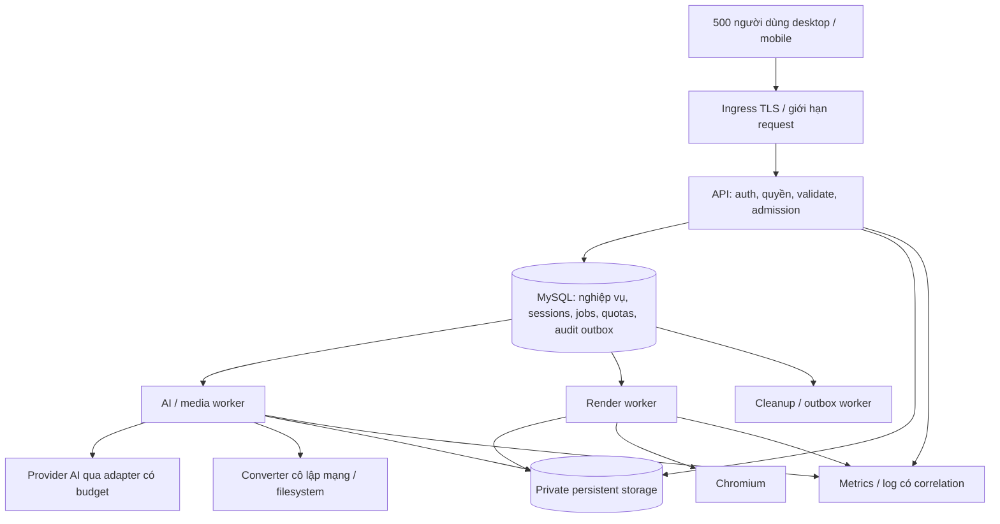

# Kế hoạch nâng cấp MISA HTML Presentation để duyệt

Ngày 11/10/2026 · Áp dụng commit `ec7bdf78d1928c7c66477109761fcc57451873c7` và các thay đổi được review sau đó.

**Đề nghị duyệt:** triển khai theo hướng test-first, sửa lỗi có bằng chứng, tách tác vụ nặng ra worker có job bền vững, đặt ngân sách tài nguyên, rồi kiểm chứng Docker với 500 người dùng đồng thời trước bàn giao DevOps. Giữ Node/Express/MySQL/Vue, mô hình tenant và tính năng hiện có. Chưa thay đổi mã ứng dụng trong lần audit này.

Gói duyệt gồm 21 finding, 21 work item W00–W20, 198 kịch bản kiểm thử và 76 mục checklist đối chiếu nguồn MISA. Có phụ lục cho org/redraw đang được phát triển đồng thời: trước W01/W02 chốt commit hoặc diff mới, cập nhật inventory và chạy lại baseline. Không dùng kết quả test cũ để nghiệm thu working tree mới.

## 1. Định nghĩa kết quả cần đạt

1. Mọi tính năng/nghiệp vụ trong catalogue có test chính, quyền truy cập, biên/lỗi phù hợp; mọi API có contract test; mọi invariant có khả năng cạnh tranh được kiểm trên MySQL thật.
2. Các lỗi F01–F21 trong audit được xử lý hoặc có bằng chứng khách quan rằng không áp dụng. Unknown không được tính là pass. Ngoại lệ làm trái yêu cầu bắt buộc không được gọi là “100% tuân thủ”.
3. Tác vụ đã nhận thành công không biến mất khi restart. Không publish dữ liệu nửa chừng; người dùng thấy trạng thái job và cách thử lại rõ ràng.
4. 500 người đồng thời hoạt động theo profile tải dưới đây; quá tải phải trả lỗi có kiểm soát/Retry-After, không làm cạn RAM/disk/DB và không ảnh hưởng quyền/dữ liệu.
5. Docker image, cấu hình, migration, test evidence, dashboard, backup/restore và rollback đủ để DevOps triển khai không phải đoán.

“100%” là **100% yêu cầu áp dụng có bằng chứng nghiệm thu**, không phải lời hứa phần mềm không còn lỗi. Báo cáo cuối phải chỉ rõ danh sách N/A, các kiểm chứng production do DevOps thực hiện và ngày/commit của từng bằng chứng.

## 2. Các quyết định đưa ra để anh duyệt cùng kế hoạch

| Quyết định | Phương án đề xuất | Ảnh hưởng / lựa chọn khác |
|---|---|---|
| Nguồn chuẩn | MISA BackEnd.SKILL làm nguồn chuẩn, memory-bank bổ sung; sửa đường dẫn Windows/Xoăn lỗi thời | Không tự thay skill toàn cục; chỉ chuẩn hoá tài liệu project sau duyệt |
| Schema | `schema.sql` là baseline đầy đủ mới nhất cho DB rỗng; delta lịch sử có version/checksum; upgrade chạy thủ công bởi DevOps | Giải quyết mâu thuẫn memory rule10. Không chạy DDL khi app boot; không chỉnh delta đã chạy để che lịch sử |
| Queue | MySQL durable jobs, lease/fencing/checkpoint, worker process riêng | Giữ ít hạ tầng mới. Nếu DevOps đã vận hành Redis/BullMQ tốt, dùng ADR thay thế với transactional outbox, cùng bộ contract test |
| Storage | Giữ storage abstraction; persistent volume trong Docker một host; staging riêng của job | Nếu nhiều host, cần shared/object storage trước khi scale, không mount local volume riêng rồi coi là dữ liệu chung |
| URL import | Production dùng allowlist domain cấu hình rõ và egress chặn private network | Có thay đổi tập URL được phép. Public-web tuỳ ý cần quyết định riêng và đối chiếu lại yêu cầu chuẩn02 |
| Asset revoke | Request mạng mới mất quyền trong ≤60s; signed URL có binding/version, cache tương ứng | File đã tải/export không thu hồi được. Nếu yêu cầu tức thời, kiểm quyền mỗi request và dùng no-store |
| Đăng ký | Giữ `SELF_REGISTRATION=false`, tài khoản do admin cấp | Không mở SSO/đăng ký mới ngoài scope |
| Recovery | RPO dữ liệu đã commit mục tiêu ≤15 phút, RTO sự cố mất host mục tiêu ≤60 phút | Là mục tiêu DR đề xuất, chỉ chốt sau restore drill với dung lượng đo; job crash thông thường nhanh hơn |
| Quyền viewer | Giữ quyền xem/xuất/nhân bản và public yêu cầu đăng nhập | Không đổi ý định người dùng trước đây dưới danh nghĩa bảo mật |

Mâu thuẫn schema cần chủ dự án chọn trước W15. [Skill đã đọc](/Users/tuanbui/.codex/skills/misa-backend-standards/SKILL.md) yêu cầu: “when rules conflict, surface the conflict and ask the project owner rather than guessing.” Đây là một quyết định nằm trong gói duyệt kế hoạch; chưa cần dừng các phần test/audit không phụ thuộc nó.

## 3. Kiến trúc đích

Bản Docker nghiệm thu khởi đầu một API, các worker riêng; mọi job/lease/quota cần chia sẻ được lưu ngoài RAM. Chạy thử hai API trên cùng hạ tầng test là gate chống việc vô tình phụ thuộc process; không đồng nghĩa đạt HA nhiều host. Không tách microservice/domain hoặc thêm Kubernetes chỉ để thỏa số 500.

### 3.1 Job và đảm bảo dữ liệu

- Một transaction ngắn ghi trạng thái nghiệp vụ + job record; chỉ trả 202 khi dữ liệu cần khôi phục đã bền vững. Không enqueue RAM rồi hy vọng process sống.
- Jobs tối thiểu: id, tenant/deck, type, payload/schemaVersion, input/specVersion, idempotencyKey, status, priority, availableAt, attempts, leaseOwner/token, leaseUntil, heartbeatAt, deadline, resultRef, errorCode, correlationId. Unique idempotency key theo tenant + operation + payload digest; cùng key khác payload trả409.
- Worker claim bằng transaction `FOR UPDATE SKIP LOCKED`, commit ngay rồi mới chạy I/O. Finish/checkpoint phải so lease token và input version; worker cũ không được ghi sau khi lease bị worker khác nhận.
- Delivery là at-least-once; dùng dedup/conditional publish để hiệu ứng DB không bị nhân đôi. Không hứa exactly-once đối với provider AI không hỗ trợ idempotency: timeout sau khi provider nhận có thể đã bị tính phí. Ghi nhận kết quả không chắc chắn, giới hạn retry và quota tiền; không retry mù quáng mọi POST.
- Checkpoint sau ingest/outline/design/media; giữ artifact đầu vào đến khi job terminal và qua retention. Delete deck/thu hồi quyền/disable user khi job đang chạy phải có quy tắc huỷ hoặc không publish, được test.
- `queued → running → succeeded`; retryable đi `retry_wait`, hết budget đi `failed`; `cancelled` có lý do. UI nhận job status nhưng vẫn giữ trạng thái deck mà người dùng quen. Không gộp trạng thái deck với lease vận hành.
- Các reservation active/pending/quota dùng DB atomic; deadlock retry tối đa có jitter. Shared rate-limit store ban đầu dùng bảng bucket ngắn hạn + pool/budget riêng, đo overhead ở gate tải; không dùng một global lock cho mọi API. Nếu overhead không đạt, chuyển store sang Redis theo ADR, giữ nguyên interface/test.
- Dọn staging/output/provider file theo manifest và TTL; biết job nào còn sống. GC kiểm cả current spec, outline, handoff, template và operation đang chạy. Không xoá asset chỉ vì không còn trên slide hiện tại.

### 3.2 Cập nhật đồng thời và dữ liệu tệp

- Editor giữ riêng `serverSnapshot`, `draftBaseVersion`, `localRevision`, `lastSentRevision`. Response metadata không thay baseVersion của draft cũ; save response không xoá text gõ sau lúc gửi.
- Khi409: giữ draft, cho tải bản server/so sánh/thử lại có chủ đích. Không tự retry bằng version mới vì sẽ biến optimistic lock thành lost update.
- Share/baseline/quota lock theo deck; invariant “ít nhất một active admin” lock trên dòng guard chung và đọc lại actor/target trong transaction. Chỉ khoá các dòng admin riêng lẻ không đủ chống hai admin hạ quyền nhau.
- File copy/AI/storage nằm ngoài transaction dài. Ghi operation manifest, copy vào staging, kiểm checksum; một transaction ngắn publish rows/reference; cleanup retry nếu abort. Duplicate chỉ hiển thị `ready` khi asset remap hoàn chỉnh.
- Thay đổi schema theo expand → deploy tương thích → backfill → verify → contract ở release khác. Rollback ứng dụng không tự chạy down migration phá dữ liệu.

## 4. Chiến lược test trước khi nâng cấp

### 4.1 Gate T1: bổ sung toàn bộ catalogue hiện tại trước sửa logic

1. Lưu baseline HEAD, manifest và 134 test hiện có. Chạy lại unit bằng dependency đã pin và build sạch trong CI; không dùng test tạo tài khoản trong DB thật.
2. Hoàn thiện [catalogue test](03-ma-tran-test-case.csv) thành test runnable: unit/domain, HTTP thật, MySQL8.4 thật, storage temporary thật, component/browser. Các ID trong CSV là đặc tả, **chưa phải test code đã được cài đặt**.
3. Dựng Docker test project riêng, DB/schema/volume riêng, port động, provider stub có seed/delay/error script. Refuse chạy nếu DSN/storage trỏ môi trường ngoài allowlist test. Seed người dùng qua fixture DB rồi login qua route thật, không thêm route bypass vào production.
4. Chốt expected behaviour từ code + memory-bank + yêu cầu đã xác nhận. Những hành vi là bug được viết thành test kỳ vọng đúng và chứng minh red trên baseline; không viết assertion “bug phải tiếp tục xảy ra”.
5. Báo cáo baseline gồm suite bảo vệ hành vi đúng đang green và danh sách defect test đang red có ID finding. Không che bằng skip/todo rồi công bố toàn bộ green. Gate cho phép bước sửa lỗi F01… có danh sách red đã xác nhận; sau sửa, tất cả test tương ứng phải green trước merge.
6. Các khả năng hoàn toàn mới như durable lease chưa tồn tại được đặc tả ngay; test red được thêm ở đầu ticket tương ứng trước implementation. Điều này khác với bỏ trống regression cho tính năng cũ.

### 4.2 Fixtures và oracle

- Users: owner A, editor B, viewer C, stranger D, admin E, admin F, disabled G, must-change H; ít nhất hai tenant. Deck private/public/shared ở mọi state; 99/100shares, 4/5handoffs, quota asset sát trần.
- Tệp thật nhỏ và hợp lệ: DOCX/PPTX/XLSX/ODT/ODS/ODP theo loại parser hỗ trợ, PDF text/scan, TXT/HTML, JPEG/PNG/WebP/HEIC, MP3/WAV, MP4/WebM phát được. File hỏng, sai magic, ZIP nén phình, tên Unicode/path, external relationship variants. Không dùng fake MP4 header để kết luận playback.
- AI stub trả JSON đúng/sai/thiếu trang, sai ref, delayed,429/503, upload late-success/late-failure, file processing never-active. Expected nội dung dựa fixture đã duyệt; không snapshot nguyên chuỗi AI thật biến động.
- Screenshot/render assertions kiểm text/tràn khung/asset/layout/print, mask timestamp/random seed. Golden chỉ cập nhật khi đã review, không tự “update snapshot” cho qua.
- Race test dùng barrier và connection độc lập, assert DB invariant sau commit. Nhiều lời gọi async qua mock không thay thế bước này.
- Coverage include toàn bộ first-party source liên quan kể cả file chưa import. Mục tiêu phụ ≥85% line, ≥80% branch; auth/ACL/invariant/state transitions phải đủ các nhánh đặc tả. Không đạt metric không được chữa bằng loại tệp cốt lõi khỏi denominator.

### 4.3 Gate theo từng thay đổi

Mỗi PR: test đặc thù + toàn bộ suite hiện có có thể chạy deterministic + build; đối chiếu contract/memory-bank. Suite integration/concurrency chạy thật trong CI. Full E2E/load/fault ở gate release và bất kỳ PR chạm concurrency/resource/shutdown; kết quả không đủ điều kiện chạy phải ghi pending, không coi pass. Không broaden test vô hạn khi không có thay đổi/rủi ro mới.

## 5. Danh sách work item có thể giao triển khai

Test family dưới đây liên kết tới cột “Nhóm” trong CSV. Mỗi item cần PR riêng hoặc các PR nhỏ kế tiếp; tách PR di chuyển code khỏi PR đổi hành vi.

| ID / phụ thuộc | Công việc, vùng mã | Test phải có trước | Tiêu chí hoàn tất và rollback |
|---|---|---|---|
| W00 / duyệt plan | Chốt ADR queue/schema/URL/revoke/SLO; cập nhật nguồn chuẩn trong AGENTS, CLAUDE, memory11 | DOC/OPS checklist; diff chỉ tài liệu | Không còn chỉ dẫn xung đột; chủ dự án duyệt ADR. Revert docs nếu chưa thống nhất |
| W01 / W00 | Test harness: test config độc lập, MySQL/volumes cô lập, factories, stub providers, deterministic clock/barriers, CI skeleton; sửa script integration | AUTH,DATA,SEC guard tự kiểm test harness không trỏ DB thật | 134 unit giữ nguyên kết quả; integration command có test thật; mọi artifact có seed/commit |
| W02 / W01 | Viết toàn bộ regression của tính năng hiện có: routes, services, composables, desktop/mobile, render/export; map API→test, critical states→test | Toàn bộ catalogue chức năng, đặc biệt SRC/EDIT/SHARE/EXPORT | Gate T1 có báo cáo green và known-red minh bạch trước sửa application logic |
| W03 / W02 | Sửa hợp đồng storeImage và caller source/poster/AI; kiểm tenant/deck và buffer ở boundary | SRC ảnh kèm/poster; MEDIA minh hoạ; ACL editor media | Không `tenants/undefined`; ảnh đúng kind/tenant; AI optional lỗi có cảnh báo. Revert PR độc lập |
| W04 / W02 | Sửa draft/version/meta/in-flight response ở editor và outline; giữ draft khi409, khi rotate/mobile | EDIT hai client; gõ trong lúc lưu; OUT/save-build race | Không lost update;409 có UI giữ nháp; đổi ratio không rebase ngầm. Revert không đổi schema |
| W05 / W02 | Tx/lock invariant admin/share/baseline; atomic quotas; password CAS; duplicate email mapping | AUTH/SHARE/MEDIA/DATA trên MySQL với barriers | ≥1 active admin; share≤100; baseline đúng trước quyền mới; quota không vượt dưới50 racers |
| W06 / W02,W03 | Cleanup provider theo all-settled/abort; operation manifests và compensation duplicate/template/asset/delete/thumbnail | MEDIA late upload; TPL/EXPORT failure từng bước; DATA delete-retry | Không ready thiếu tệp; không orphan ngoài TTL; crash giữa SQL/filesystem khôi phục được; giữ snapshot asset |
| W07 / W02 | Streaming upload budget, slot/quota; đổi limiter theo IP+user+cost, shared store abstraction; cap trước RAM/disk | SEC chunked/abort/spoof, LOAD same NAT, MEDIA cap boundaries | 413 sớm theo byte thực; overload429/503 có Retry-After; user hợp lệ không bị gom600/IP |
| W08 / W02 | Password72byte, forced-change assets, capability revoke, HTTPS/cookie/strict config, credential rotation | AUTH unicode/legacy, ACL signed/unsigned, SEC prod-config | Không truncation password mới; tài khoản cũ có đường đổi an toàn; revoke≤60s; fail-fast cấu hình nguy hiểm |
| W09 / W03–W06 | Tách cơ học presentation orchestration thành ingest/build/media/export/version modules sau khi regression ổn | Toàn bộ regression + contract diff | PR chỉ di chuyển, output/state không đổi; tránh một PR vừa đổi cấu trúc vừa sửa nghiệp vụ |
| W10 / W09,W15 | Implement job table/repository, lease/fencing/checkpoint/retry/cancel/idempotency/cleanup ledger; worker entrypoint | JOB,DATA race/kill/restart/dedup trước từng phần |202 chỉ sau durable commit; worker cũ không publish; retry không nhân bản dữ liệu; không giữ DBtx khi gọiAI |
| W11 / W10 | Bỏ recover-all/cleanup-all; worker-aware recovery; shutdown drain/readiness; grace budget Docker; UI progress/backoff+jitter | JOB/OPS SIGTERM,SIGKILL,2API,expiredlease; OUT polling | Restart API không làm fail job đang chạy ở worker; upload live không bị dọn; grace/deadline đo được |
| W12 / W09,W10 | Render/export job admission trước materialize; asset dependency graph; stream artifact; thumbnail coalesce by version | EXPORT large media/unused media/cancel; DESIGN print | Không nạp media không cần; tài nguyên nằm dưới budget; timeout không để Chromium mồ côi |
| W13 / W10,W12 | Frontend dùng export job/status/download; compatible bridge endpoint cũ; thông báo quá tải/thử lại | EXPORT E2E desktop/mobile viewer; old-client contract | Người dùng tải đúng version; refresh không sinh job đôi; bridge có thời hạn, không block vô hạn |
| W14 / W02,W10 | Converter worker cô lập no-network/minimal-env/scoped volume; ONNX/Sharp/Chromium pool resource caps | SRC/SEC malformed/zip/externalfile; OPSkill/nativefail | Sentinel file/env không bị đọc/ra ngoài; child process killed; failure có fallback đúng, không bỏ media bắt buộc |
| W15 / W00,W01 | Baseline/delta/preflight DB_NAME, schema contract check; acquire/query/tx deadline; migration replay và rollback drills | DATA fresh/upgrade/replay/brand enum/template tables/UTC | Fresh và upgraded schema tương đương; không marker giả; app không tựDDL; query timeout không ròconnection |
| W16 / W02,W05 | Pagination template ổn định; review query plans trên dataset synthetic; index theo EXPLAIN; asset/list payload | TPL >100; DATA pages/ties/tenant; LOAD DB | Truy cập được mọi mẫu hợp lệ; không N+1/response spec lớn ở list; không thêm index theo cảm giác |
| W17 / W07,W08,W11,W14 | Docker production profile: ingress/TLS, only necessary ports/env/secrets, immutable image, limits, nonroot, probes; SBOM/dependency/image scan | OPS cleanbuild amd64/arm64 nếu bàn giao cả hai; SEC secrets/proxy | Docker ổn định dưới target limits; package clean build; không unresolved critical/high có thể khai thác trong đường chạy |
| W18 / W10,W17 | Request→job correlation, safe logs, metrics, dashboard/alert; audit transactional outbox cho thao tác quan trọng | SEC log canary; OPS audit sink down/metrics cardinality | Không mất audit đã commit; không logpassword/token/content nhạy cảm; alert thử kích hoạt và nhận được |
| W19 / W04–W18 | Load500,stress1000,burst heavy,soak8h,fault-injection; kiểm quyền và dữ liệu sau test | LOAD/JOB/OPS/ACL toàn bộ | Báo cáo p95/p99/error/resource/queue/recovery kèm raw artifacts; tiêu chí mục6 đạt, không chỉ throughput |
| W20 / W17–W19 | Backup/restore/rollback runbook và drill; cập nhật memory01–11, API/job docs, checklist tuân thủ, gói DevOps | OPS restore cảDB+assets, hash/media/snapshot/rights, rollback | Restore đạt RPO/RTO; người DevOps khác chạy theo runbook; tất cả control áp dụng có evidence |

Thứ tự chính: W00 → W01 → W02 → W03–W08 → W09 → W10–W14 → W17–W19 → W20. W15 bắt đầu sau W01 và xong trước W10; W16 sau W05; W18 có thể chuẩn bị sớm nhưng chỉ nghiệm thu với job thật. Không triển khai task phụ thuộc vào ADR còn chưa chốt.

## 6. Kịch bản 500 người đồng thời và tiêu chí chịu tải

### 6.1 Giả định workload để phê duyệt

500 người đăng nhập đồng thời, có think time; **không mặc định 500 job Gemini/PDF chạy song song**. Mọi nhóm bên dưới đồng thời tồn tại, tổng500:

| Nhóm | Số người | Hành vi |
|---|---:|---|
| Xem/tìm/trình chiếu |300| List/search/open deck, tải asset có cache hợp lệ, chuyển slide |
| Chỉnh sửa |150| Mở deck, sửa nội dung, lưu mỗi20–60s; một số cặp cùng bài |
| Dàn ý/job |40| Theo dõi trạng thái với backoff/jitter, sửa outline; tạo/build theo arrival rate bên dưới |
| Media/xuất |10| Upload/import/cutout/export theo kịch bản có giới hạn |

Tách bài test 500 virtual users có think time khỏi bài 100 request/giây API nhẹ. Không suy ra RPS duy nhất từ số users. Cả hai cần đạt. Đo riêng cache cold/warm, NAT chung và nhiều IP, trình duyệt thật và HTTP generator.

- Steady AI: **1 bài mới/phút**, tính đủ hai stage outline/build; provider stub mô phỏng latency thực tế. Burst20 yêu cầu tạo/build trong10s, có thông báo queue/overload.
- Steady PDF:4 lượt/phút, burst20 yêu cầu trong10s; workload10–20 slides thông thường,40 slides tối đa và nhiều ảnh theo fixture.
- Upload:10 concurrent, case phổ biến20 MB và boundary300 MB; đo trên đường truyền biết băng thông, không đặt SLA upload bỏ qua network của người dùng.
- Read data: tối thiểu10.000deck synthetic,500 users active; tăng100.000deck để xem query plans; file fixture dung lượng phù hợp host test. Không copy tài liệu nội bộ thật.
- Profile đồng NAT:500 users chung một IP; profile loginstorm500 trong60s, burstassets khi mở deck; không bỏ auth/rate limiter để đẹp số.

### 6.2 Ngân sách khởi điểm — phải hiệu chỉnh bằng đo

| Tài nguyên | Giá trị thử ban đầu | Cơ chế khi hết |
|---|---|---|
| AI stage đang chạy |4 toàn hệ thống,1/tenant| Admission atomic, provider quota/budget thấp hơn được ưu tiên |
| AI pending |20 toàn hệ thống,2/tenant| Từ chối thêm nếu estimated wait vượt10 phút hoặc vượt cap; không nhận rồi mất |
| Chromium render |2 toàn hệ thống| Queue≤8, pending deadline≤120s; cancel khi hết hạn |
| Office convert |1 mỗi worker được cấp CPU/RAM| Queue hữu hạn, process timeout/kill, không giữ slotAPI |
| Upload |10 đang nhận toàn hệ thống ở profile test| Reservation disk;413/429/503 rõ; retry có idempotency |
| DB pool |API20; từng worker5–10, tổng có headroomDB| Giới hạn queue/acquire; không mỗi replica nhân pool vô hạn |
| API thông thường |Deadline10s, readycheck2s|503/504 có code; ngắt công việc phụ thuộc, không chỉ Promise.race bỏ mặcquery |
| External fetch |Budget tổng gồmDNS/redirect/body| Abort thực; retry hữu hạn theo loại lỗi/idempotency |

Ví dụ năng lực AI: nếu mean mỗi stage90s và4 slots thì lý thuyết2,67stage/phút; hai stage/bài tương đương1,33 bài/phút, profile1 bài/phút dùng~75%. Nếu đo mean180s/stage thì cấu hình này **không đủ**: phải giảm arrival được nhận hoặc tăng quota/slots sau khi kiểm RAM/chi phí. Không cam kết provider latency từ số giả định. Queue wait và execution phải đo riêng; 202 nhanh không chứng minh job hoàn tất nhanh.

Máy benchmark đề xuất để bắt đầu: host16 vCPU/32 GiB RAM SSD, load generator riêng. Budget container dự kiến API2 vCPU/2 GiB, AI/media2 vCPU/3 GiB, render2 vCPU/3 GiB, converter2 vCPU/3 GiB, MySQL2 vCPU/4 GiB; chừa headroom cho OS/monitoring/cache. Đây là cấu hình thí nghiệm, **không phải cam kết sizing hoặc yêu cầu mua máy**. Disk staging tối thiểu đủ10×300 MB và bản chuyển đổi, đặt cap/low-watermark; storage lâu dài tính theo retention/dữ liệu, không theo mỗi số500 users.

### 6.3 SLO nghiệm thu đề xuất

| Chỉ tiêu | Ngưỡng |
|---|---|
| API nhẹ list/detail/authenticated metadata |p95≤500ms, p99≤1.5s trên profile steady, đo server và network riêng |
| Lưu spec/outline |p95≤800ms, p99≤2s; không mất dữ liệu,409 đúng khi cạnh tranh |
| Nhận job/tra trạng thái |p95≤1s cho request nhỏ sau upload;202≤2s sau durable acceptance |
| Lỗi ngoài dự kiến |<0,5% steady; tách403/409mongđợi và429/503chủđộng; báo riêng tỷ lệ reject hợp lệ, không giấu |
| Reject hợp lệ ở steady |≤1% cho thao tác trong quota; nếu cao hơn coi không đạt capacity |
| PDF chuẩn20 slides |p95 execution≤30s, end-to-end≤120s ở steady/burst đã chấp nhận |
| AI |Theo provider stub latency và quota đã công bố; p95 queue wait≤10 phút; latency thật là gate thử riêng |
| Memory/process |KhôngOOM/restart; peakRSS<80%limit; plateau sauwarmup, không tăng kéo dài qua8h; event-loop lag p99<100msAPI |
| DB |Không connectionleak/deadlock không xử lý; acquire p95<100ms steady; metrics pool/query/lock rõ |
| Worker crash |Job được nhận lại≤120s sau lease hết hạn theo cấu hình; không nhân đôi publish, không mất input |
| Storage/provider cleanup |Không orphan ngoàiTTL đã chốt; mọi cleanup thất bại có retry/alert |
| Revocation/tenant |0 đọc/ghi chéo tenant; revoke theo≤60s; không cache lẫn quyền |

AI real-provider smoke sau khi có test credential/budget giới hạn, không dùng500calls thật để “loadtest”. Đo ứng dụng bằng provider stub; đo quota/latency nhà cung cấp qua mẫu thật nhỏ có kiểm soát. Hai loại bằng chứng phải tách rõ.

### 6.4 Chuỗi thực thi tải và lỗi

1. Sanity20 users10 phút → ramp50/100/250/500 mỗi10 phút → steady500 trong60 phút.
2. Open-arrival100 RPS API nhẹ trong30 phút; tăng tới ngưỡng để tìm điểm bão hoà. Không coi closed-loop giảm tốc là hệ thống vẫn khoẻ.
3. BurstAI/PDF/upload +500 người đang hoạt động; verify admission/fairness, người đọc không bị job nặng chiếm hết.
4. Stress1000 users15 phút: không yêu cầu giữ SLA500, nhưng phải từ chối có kiểm soát; hạ về500 thì phục hồi≤5 phút, không restart dây chuyền.
5. Soak500 trong8 giờ: theo dõi memory, fd, pool, sessions, timers, disk, orphan, queue oldest age và cost.
6. Fault: killAPI, killworker giữa upload/AI/publish; MySQL mất kết nối/lock; provider429/503/hang; diskfull; Chromiumcrash; Officehang; log/auditsinkfail; clock/lease boundary; hai worker giành cùng job.
7. Sau mỗi fault: query invariant, hash source/output, ACLcheck, version/historycheck; chạy lại suite hồi quy. Không kết thúc chỉ vì healthendpoint xanh.

## 7. DevOps, migration và phát hành

Gói bàn giao gồm image bất biến theo commit/digest +SBOM, Docker production/test profiles, danh sáchenv không chứa secret, sơ đồ ingress/egress/volume, quyềnDB tối thiểu, migration checklist, SLOdashboard/alert, test reports, backup/restore/rollback runbooks và memory-bank cập nhật.

- CI: syntax/lint phù hợp → unit/domain → MySQLintegration/concurrency → frontendbuild → E2E → Docker build → dependency/image scan. Release candidate thêm load/fault/restore. PR template có finding/test/memory-bank/rollback.
- Migration: backup và đo restore trước; chạy delta có checksum bằng rolemigration riêng; preflightschema; deploy app tương thích. Không dùng `schema.sql` như upgrade script lên DB đã có dữ liệu.
- Storage backup đồng bộ với DB snapshot/manifest; nếu RPO15 phút thì cần cơ chế incremental/binlog và asset replication/versioning tương ứng. Backup chỉ nightly không đạt mục tiêu này.
- Release: staging đạt gate → đóng image → DevOps rollout theo môi trường thật. Có readiness drain và giới hạn thời gian; single-host dùng cửa sổ triển khai phù hợp, không gọi là zero downtime.
- Rollback: dừng nhận job versionmới, giữ/checkpoint jobs đã nhận, rollback image tương thích schema; không xóa job/input. Nếu schema destructive đã áp dụng phải có restore riêng, không giả định revertGit khôi phục được dữ liệu.
- Diễn tập restore sang stack mới: users/session policy, deck counts/checksums, media phát được, snapshot/ACL đúng, job terminal/retry đúng, đồng hồUTC. Ghi thời gian thực và lượng dữ liệu; DevOps khác chạy lại theo tài liệu.
- Post-release observation: dashboard và checklist30–60 phút ban đầu rồi theo chính sách vận hành; automation theo dõi chỉ thiết lập khi được yêu cầu riêng. Không tự deploy production trong phạm vi plan này.

## 8. Ước lượng và điều kiện dừng

| Chặng | Ước lượng công sức |
|---|---:|
| ChốtADR, test harness, regression toàn chức năng |12–18 ngày công |
| Sửa lỗi nghiệp vụ/concurrency và tách cơ học |7–10 ngày công |
| Durable jobs, recovery, export workflow |8–12 ngày công |
| Resource budgets, security, converter isolation |9–14 ngày công |
| Docker/CI/observability/DevOps |5–8 ngày công |
| Load/fault/restore và xử lý kết quả |5–7 ngày công |
| Tổng tham chiếu |46–69 ngày công |

Với2 dev và1 QA tham gia thực chất, dự kiến6–9 tuần lịch gồm phụ thuộc, review và ổn định; đây là khoảng ước lượng từ audit, không phải cam kết. Đánh giá lại sau W02 vì baseline có thể lộ thêm lỗi. Chưa gồm procurement hạ tầng, SSO mới, chính sách tổ chức hoặc thay đổi yêu cầu.

Dừng merge/release nếu có P1 chưa xử lý, regression chưa giải thích, dữ liệu bị ghi đè/chéo tenant, tải cần tắt bảo vệ mới đạt, restore chưa thành công, hoặc có control bắt buộc chưa có bằng chứng. Lỗi ngoài scope được đưa vào finding mới và xin duyệt bổ sung phạm vi; không tự đổi nghiệp vụ để cho test pass.

## 9. Cách duyệt

Anh có thể duyệt toàn bộ hướng triển khai hoặc điều chỉnh các quyết định ở mục2, nhất là schema, URLallowlist, queue, revoke và RPO/RTO. Sau khi duyệt, bước đầu tiên là W00–W02 để dựng test; chỉ qua Gate T1 mới sửa logic ứng dụng. Việc đợi duyệt là theo yêu cầu trực tiếp của anh ở lần giao việc này; báo cáo hiện tại đã đủ cụ thể để review mà chưa cần sửa source.
